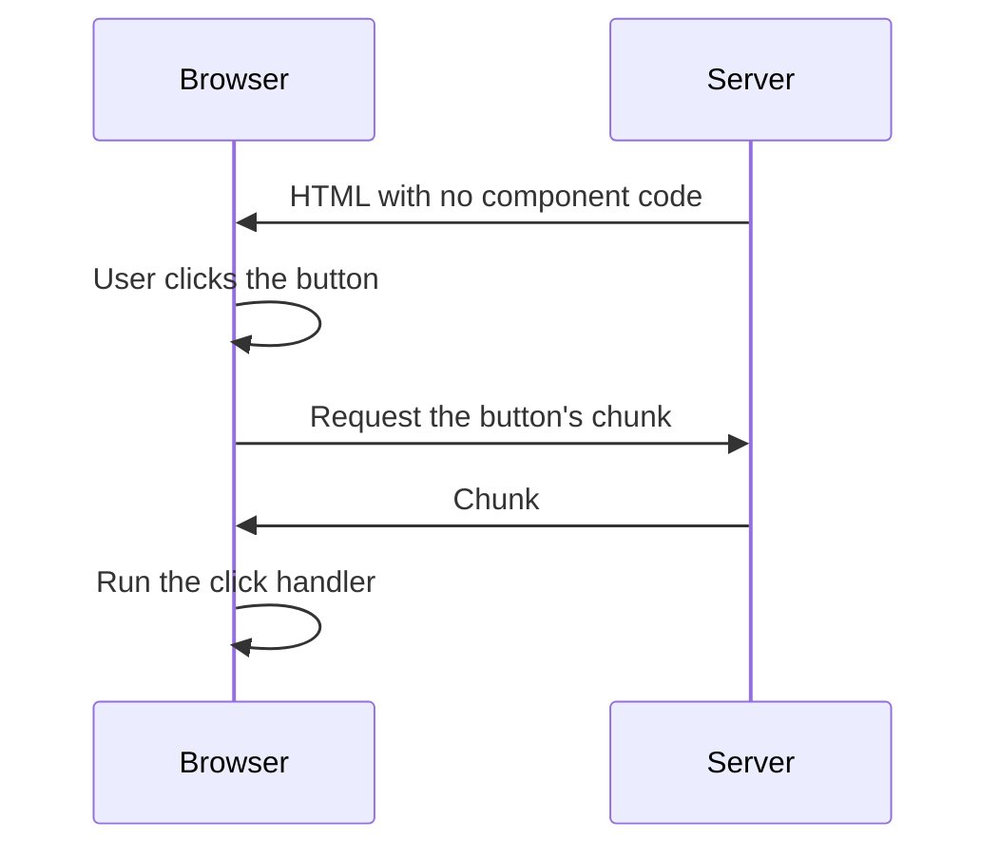

# Diagrams

Concept, feature and internals pages explain structure and order. A diagram shows both faster than prose. Use one when a page describes more than two parts that interact, or more than two steps over time.

## Picking the diagram

| To show | Use |
|---|---|
| Steps in order, with branches | Flowchart |
| Messages between parts over time (client, server, worker) | Sequence diagram |
| Parts and what connects them | Box-and-arrow (component) diagram |
| States and the events that move between them | State diagram |
| Code before and after a transform | Two code blocks side by side, not a picture |
| Data shapes and their relations | Entity diagram or a typed code block |

## Rules

- **One idea per diagram.** A diagram that needs a legend with more than four entries shows two ideas. Split it.
- **Text source in the repo.** Write diagrams in Mermaid, or as SVG generated from a source file. Text source shows changes in diffs, can be translated, and is not lost when the tool that drew it is gone. Never commit only a PNG from a drawing tool.
- **Same shape, same meaning.** Pick one notation for the site and keep it: for example, rounded boxes for user code, square boxes for the product, dashed arrows for things that happen later. Describe the notation once on the contributing page.
- **Labels in the docs' terms.** Use the exact names from the concept pages and the glossary. A box called "renderer" on a page that says "the runtime" makes the reader think they are two things.
- **Few words.** Labels are names, not sentences. Explanation goes in the text around the diagram.
- **Readable at page width.** No more than about seven boxes or ten steps. Check it in light and dark themes and at 390 px wide, or let it scroll sideways without shrinking the text.
- **Not by color alone.** Color can repeat a distinction, but shape, line style or a label must carry it too.

## Around the diagram

- **Lead into it.** The sentence before the diagram says what it shows: "A request passes through three stages before it reaches your handler."
- **Alt text states the point**, not the shapes: "The compiler splits each component into a server part and a client part, and the client part loads on first click." For Mermaid, put this in an `accTitle` and `accDescr` or a caption the screen reader reaches.
- **Caption** when the diagram is referred to from elsewhere on the page.
- **Walk through it.** For anything with more than three steps, follow the diagram with a numbered list, one item per step.

## Example

